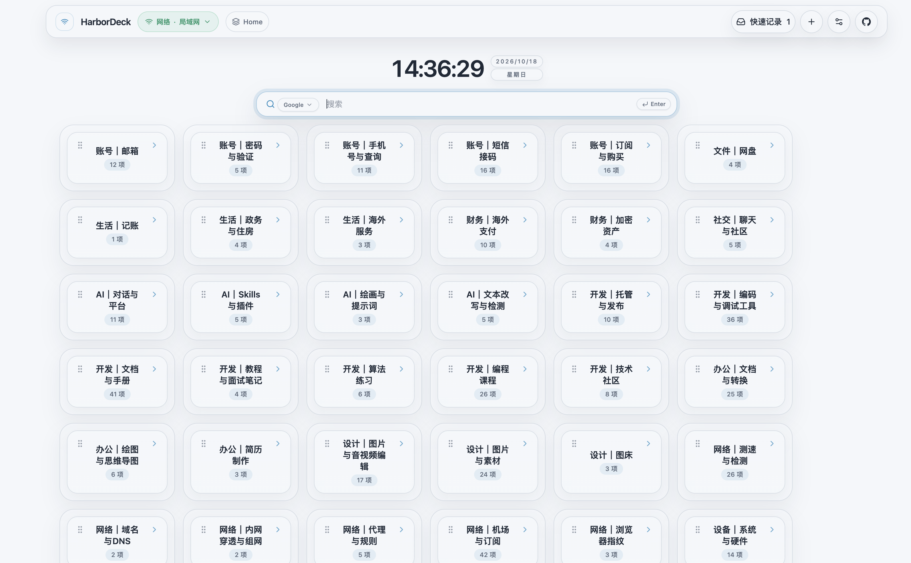
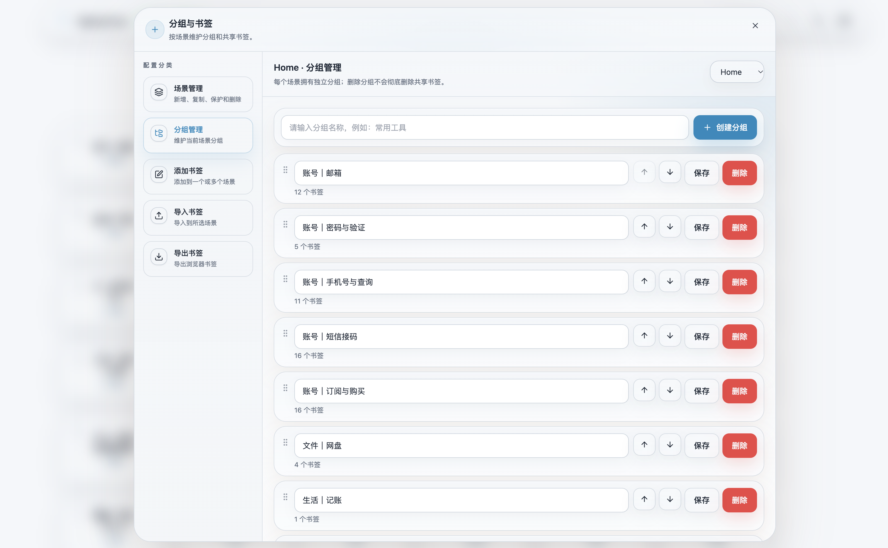
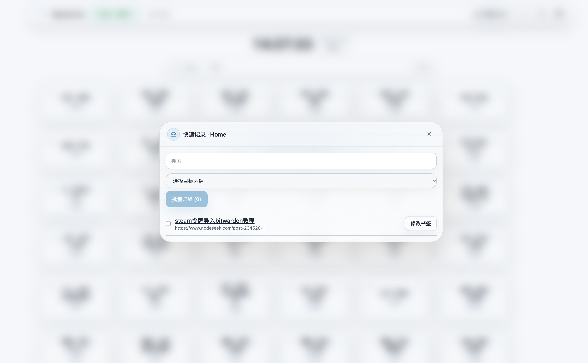
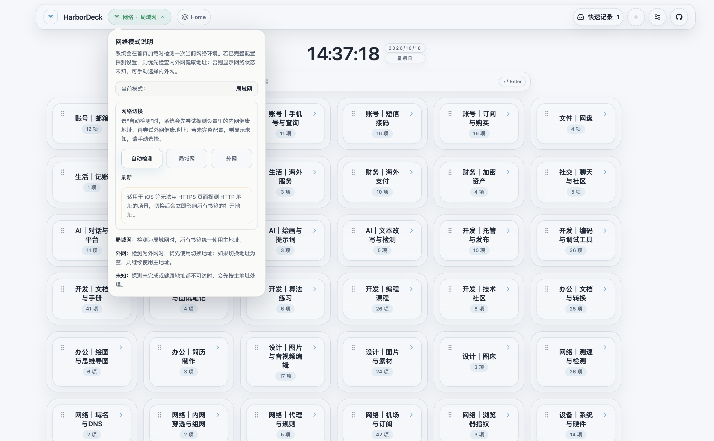
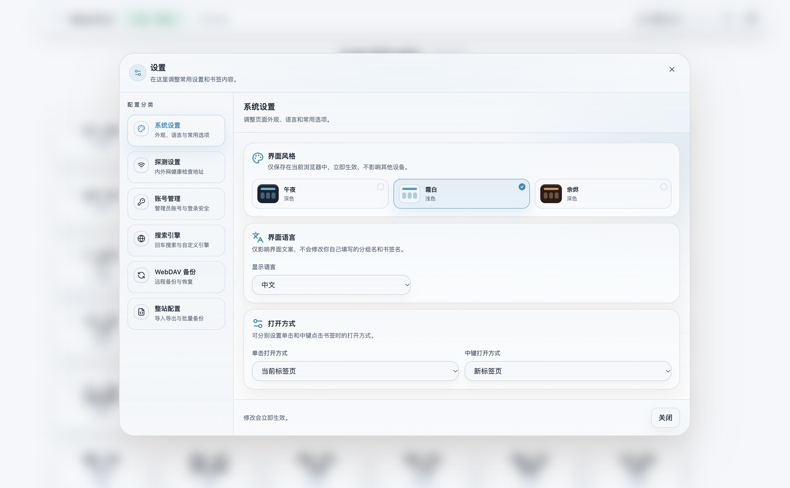
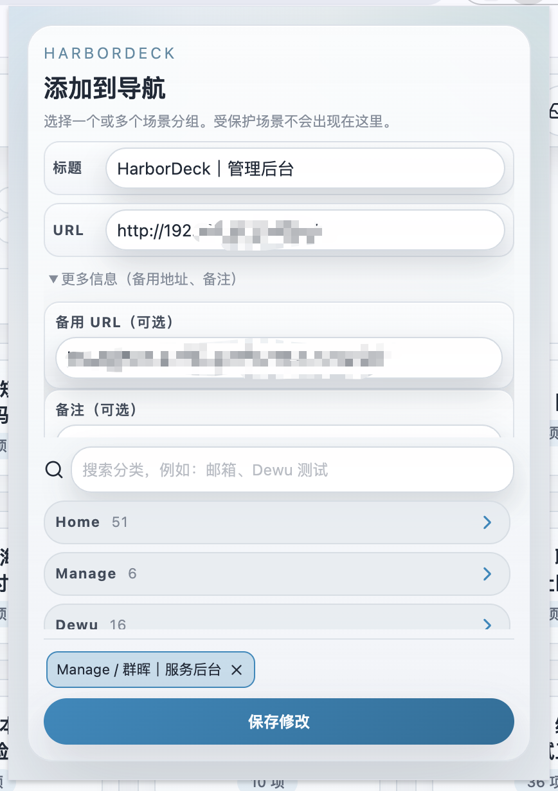
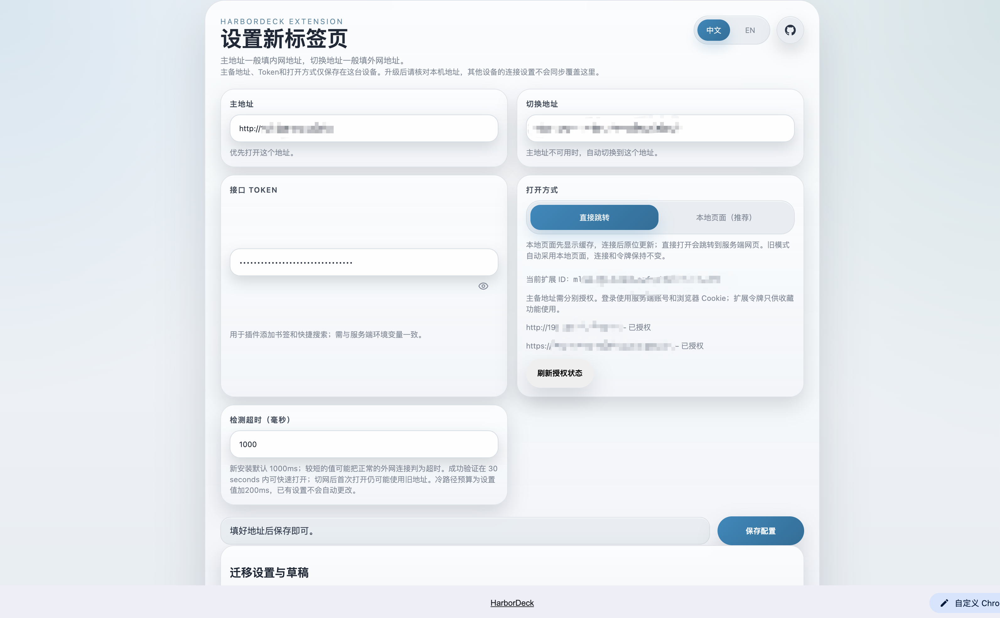

<p align="center"></p>
<h1 align="center">HarborDeck</h1>
<p align="center"><strong>Self-hosted bookmarks, ready for AI tools. Your collection, your control.</strong></p>
<p align="center">Run locally · Organize by scene · Automate through APIs · Browse with Chrome / Edge</p>
<p align="center"><a href="README.zh-CN.md">简体中文</a> · <a href="https://github.com/SageSang/harbor-deck/releases">Downloads</a> · <a href="docs/bookmark-management-api.md">Management API</a> · <a href="PRIVACY.md">Privacy</a></p>

Bring everyday websites, learning resources, and self-hosted services into a start page of your own. Run HarborDeck on your computer, NAS, or server; organize bookmarks by scene and group; capture links from your browser; and connect an AI tool of your choice through the management API to help organize a growing collection.

There is no hosted account to register. Configuration lives in your mounted directory. Built for a single administrator, HarborDeck includes site authentication, optional scene passwords, backups, and exports. You decide whether to connect AI and which data to share with external tools.

## Web app: your dashboard and bookmark workspace

Search your collection, switch scenes, and browse grouped links from one homepage. Give a service both a LAN and a WAN address to keep a familiar starting point at home and away.



| Capability                   | How it helps                                                                                                                                                                   |
| ---------------------------- | ------------------------------------------------------------------------------------------------------------------------------------------------------------------------------ |
| Scenes and groups            | Separate work, learning, home services, and personal collections. Reorder groups and bookmarks to suit your workflow.                                                          |
| Shared bookmarks             | A bookmark can appear in several scenes, with one group per scene. Editing the shared definition updates all its placements.                                                   |
| Search and keyboard access   | Filter the current scene by title, URL, or note; use built-in or custom search engines, arrow-key navigation, `/` to focus search, and Alt+Shift+arrow keys to switch scenes.  |
| Primary and fallback URLs    | Configure LAN/WAN probes and two addresses per service. Open or copy a particular address from the bookmark menu when needed.                                                  |
| Quick records                | Capture now, organize later. Search the inbox, edit notes, and move selected records into a group. Conflicting content is retained until you choose how to handle it.          |
| Bookmark tools and migration | Edit, duplicate, drag, multi-select, and place bookmarks across scenes. Import browser bookmark HTML; nested folders become path-based groups. Export browser-compatible HTML. |
| Appearance and backups       | Choose Frost, Midnight, or Ember, with Chinese and English interfaces. Export configuration or use scheduled and manual WebDAV backups.                                        |

<table>
<tr><th width="50%">Group management</th><th width="50%">Quick records</th></tr>
<tr><td></td><td></td></tr>
<tr><td>Maintain groups within a scene and adjust names and order.</td><td>Save a link now, then organize it into the right group later.</td></tr>
</table>

<details>
<summary>Web network controls: automatic detection, LAN, and WAN</summary>

Configure probe addresses for automatic detection, or select LAN or WAN manually to choose which bookmark address to use.



</details>

<details>
<summary>Web appearance settings: theme, language, and link behavior</summary>

Choose a theme and interface language, and configure how clicks and middle clicks open bookmarks. These are web app settings; extension connection settings are shown separately below.



</details>

## Browser extension: capture links and open a new tab

The Chrome and Edge extension brings HarborDeck into everyday browsing: use the toolbar popup to capture the current page and the new-tab page to open your dashboard. In local-page mode, the extension packages the frontend locally. You can browse and search ordinary-scene snapshots during connection failures, with an in-place refresh when the server becomes available.

The two views below are the **extension capture popup** and the **extension settings page**. Connection settings link the extension to your HarborDeck server; they are separate from the web appearance settings above.

<table>
<tr><th width="32%">Extension capture popup</th><th width="68%">Extension settings</th></tr>
<tr><td valign="top"></td><td valign="top"></td></tr>
<tr><td>Edit the title, URLs, and note, then save to selected scene groups.</td><td>Configure server addresses, the capture token, opening mode, and permissions. Connection settings stay on this device.</td></tr>
</table>

Screenshots were provided by the maintainer, with their original redactions preserved. Interfaces may vary between releases; features and fixes in source arrive in distributed packages when a corresponding release is published.

### Install and connect

Install from the existing [Chrome Web Store](https://chromewebstore.google.com/detail/mlnpanpmgplmlangfnokhelkhkfcpine) or [Microsoft Edge Add-ons](https://microsoftedge.microsoft.com/addons/detail/ogjfbhbheifoaidpfdbcbcbgfiblmnik) listing, or download the appropriate package from [Releases](https://github.com/SageSang/harbor-deck/releases). Store availability may lag a GitHub release.

1. Set the primary HarborDeck URL and, if useful, its fallback URL. Grant access to those origins.
2. Choose the local new-tab page or explicitly select direct navigation to your server. Connection settings belong to this installation and are not synchronized across devices.
3. Sign in with your administrator account for the navigation page. To capture bookmarks from the toolbar, also configure the server's search/capture token in the extension.
4. Use the capture popup to edit the title, URLs, and note, then search for a target scene/group or save a quick record.

Chrome and Edge have separate packages and identities. For manual installation use the corresponding unpacked ZIP; `-store.zip` files are intended for store submission. Update an existing installation in place. Before changing installation identity, use the settings export/import flow; its transfer file excludes the token, which must be entered again.

See [extension setup and recovery](docs/extension-local-settings-and-recovery.md), [package identities](docs/extension-identities.md), and [local cache behavior](docs/bookmark-cache.md).

## AI integration: let your tools organize the collection

HarborDeck provides an HTTP management API and an OpenAPI description for AI tools and automation. A client or script capable of making HTTP requests can read bookmarks, organize groups, update titles and notes, and move quick records into existing scenes. The AI comes from your chosen tool; HarborDeck does not include a built-in model or chat assistant.

For example, you could ask a connected AI tool:

> Review the quick records in Home and suggest placements using its existing groups. Preserve the original links and notes. Run a dry run and show me the changes, then wait for my confirmation before applying them.

A suggested integration flow:

1. Set `HARBORDECK_BOOKMARK_MANAGEMENT_TOKEN` to an independent random value of at least 32 characters. The management API is disabled when it is not configured.
2. Have the tool follow the [OpenAPI description](docs/bookmark-management-openapi.yaml) at `/api/management/v1`, send the token in its dedicated header, and read the current state and revision first.
3. Preview writes with `X-HarborDeck-Dry-Run: true`. Every write also requires `If-Match`; changed data causes the write to be rejected so the tool can read again and replan.

| Interface           | Access                                                                                                                                      | Documentation                                                                                        |
| ------------------- | ------------------------------------------------------------------------------------------------------------------------------------------- | ---------------------------------------------------------------------------------------------------- |
| Search and capture  | `X-HarborDeck-Search-Token`; unprotected scenes only. Useful for uTools, launchers, and bookmark capture.                                   | [Integration API](docs/api.md)                                                                       |
| Bookmark management | `X-HarborDeck-Management-Token`; groups, bookmarks, placements, and quick records across all scenes. Supports revision checks and dry runs. | [Management API](docs/bookmark-management-api.md) · [OpenAPI](docs/bookmark-management-openapi.yaml) |

The management token can read and modify bookmarks in protected scenes without administrator login or scene passwords. It cannot manage scene definitions, credentials, system settings, or WebDAV. Enable it only for tools you intend to give that scope, and keep it separate from the capture token. Configuration files and integration tokens should never be committed to Git.

Self-hosting gives you control over bookmark storage. If you connect a cloud AI tool, content that tool sends to its model may leave your machine, depending on the tool and its configuration.

## Run with Docker

The published image supports `linux/amd64` and `linux/arm64`. Docker Compose and Synology Container Manager can run it without installing Node.js on the host.

Create `compose.yaml`:

```yaml
services:
  harbor-deck:
    image: ghcr.io/sagesang/harbor-deck:1.4.28
    container_name: harbor-deck
    restart: unless-stopped
    ports:
      - '127.0.0.1:8080:80'
    environment:
      NODE_ENV: production
      PORT: '80'
      CONFIG_DIR: /app/config
      TZ: Asia/Shanghai
    volumes:
      - ./config:/app/config
    security_opt:
      - no-new-privileges:true
```

```bash
docker compose up -d
```

Open `http://localhost:8080` on the Docker host and create the administrator account. To use another device, configure an HTTPS reverse proxy or deliberately bind the port to a trusted LAN interface. The default loopback binding is not reachable directly from another computer. A reverse proxy running in another container needs a reachable upstream, such as a shared Docker network; its own `127.0.0.1` is not the Docker host.

On Synology, use a persistent host directory such as `/volume1/docker/harbor-deck/config` in place of `./config`. Keep the container path `/app/config`. The repository's [Compose file](docker-compose.yml) also includes a health check and optional integration settings.

### Versions and upgrades

The examples currently pin the published **server 1.4.28**. **Extension 1.4.29** is a separate release. A higher extension or source package version does not imply a matching Docker image; check the [release notes](https://github.com/SageSang/harbor-deck/releases) for the component you are upgrading.

Back up the complete mounted configuration directory and record the current image version before upgrading. Change the image tag, then run `docker compose pull` and `docker compose up -d`. Preserve the configuration mount, integration tokens, and any custom port mapping. A restart requires signing in and unlocking scenes again. The `latest` tag moves with server releases; pulling a fixed tag does not upgrade to a different version.

### Optional settings

| Variable                               | Purpose                                                                                                              |
| -------------------------------------- | -------------------------------------------------------------------------------------------------------------------- |
| `HARBORDECK_SEARCH_TOKEN`              | Enables authenticated shortcut search and bookmark capture for unprotected scenes.                                   |
| `HARBORDECK_BOOKMARK_MANAGEMENT_TOKEN` | Enables AI/automation management with an independent random token of at least 32 characters. Leave empty to disable. |
| `HARBORDECK_TRUST_PROXY`               | Trusted proxy IPs/CIDRs; defaults to `loopback,linklocal,uniquelocal`. Match this to your actual proxy path.         |
| `HARBORDECK_TRUSTED_EXTENSION_IDS`     | Additional trusted embedding identities. Standard HarborDeck Chrome/Edge identities are already included.            |
| `HARBORDECK_WEBDAV_TIMEOUT_MS`         | Complete timeout per WebDAV request: default `15000`, range `100`–`300000` milliseconds.                             |

## Keep control of your data

The site requires administrator authentication. Password-protected scenes add a separate visibility boundary. A bookmark deliberately shared with an ordinary scene is also visible there.

Web pages keep ordinary-scene display snapshots in `localStorage`; the extension uses `chrome.storage.local`. They contain the displayed links and notes, so treat the browser profile as private. Protected scenes are excluded even when unlocked. Offline snapshots are not backups or authorization to edit: editing requires a current online configuration, and offline writes are not queued. Logout or a detected loss of access clears the relevant cache; offline devices cannot instantly learn about remote permission changes.

Use WebDAV for a complete backup. Web configuration exports made while scenes are locked contain only accessible data. A restore replaces the current configuration; keep a fresh backup before restoring an older version. See the [privacy policy](PRIVACY.md) for storage, retention, and transfer details.

## Develop locally

Use Node.js 24 and npm:

```bash
npm ci
npm run dev
```

The web frontend is at `http://localhost:3000`; the API is at `http://localhost:3001`. Development data defaults to `./config`; set `CONFIG_DIR` to an isolated directory when testing.

```bash
npm test
npm run lint
npm run build
npm run build:extension
npm run package:extension
EXTENSION_BROWSER=edge npm run build:extension
EXTENSION_BROWSER=edge npm run package:extension
```

The project uses React, TypeScript, Vite, Tailwind CSS, Fastify, and Zod. Release tags select the deliverable: `vX.Y.Z-web` for the server, `vX.Y.Z-extension` for extensions, and `vX.Y.Z` for both. Packaging does not submit an extension to either store. See [release instructions](release-notes/README.md).

<details>
<summary>Maintainer context</summary>

Personal maintenance history, decisions, verification status, and open context are maintained in [Sidney Vault](obsidian://open?vault=sidney-vault&file=20-Areas%2F%E8%BD%AF%E4%BB%B6%E9%A1%B9%E7%9B%AE%E7%BB%B4%E6%8A%A4%2F%E5%AE%9E%E4%BD%93%2FHarborDeck%2F%E6%96%87%E6%A1%A3%2F%E8%83%8C%E6%99%AF%E5%AE%9E%E7%8E%B0%E4%B8%8E%E5%8E%86%E5%8F%B2). This repository retains source code, usage documentation, and developer contracts. The Vault is not required to build or use the project.

</details>

## License and origins

HarborDeck is licensed under [Apache-2.0](LICENSE). It originated from [Goalonez/smart-harbor](https://github.com/Goalonez/smart-harbor); thank you to the original author and contributors for the foundation. HarborDeck's ongoing development focuses on scene-based bookmark management, browser integration, and self-hosted operation.
